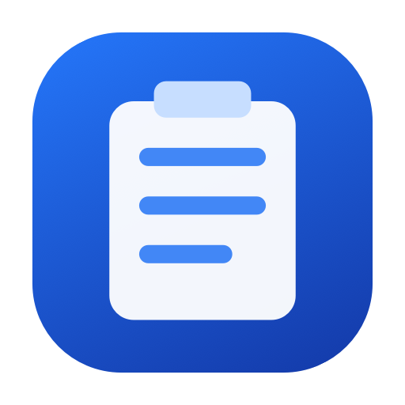
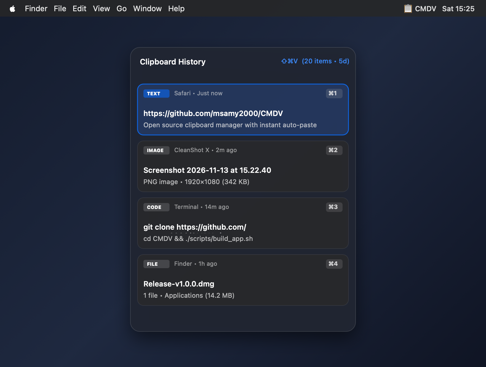
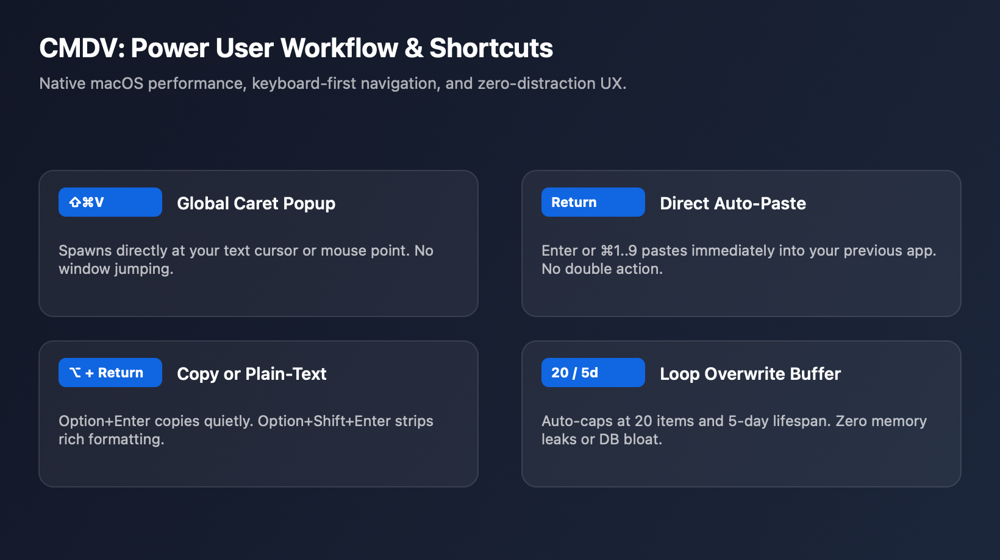

<div align="center">



# CMDV (`CMDV.app`)

**The missing Windows 11 `Win+V` clipboard history experience on macOS.**  
*Native. Blazing fast. Clean cards. Zero distraction.*

[](https://swift.org)
[](https://apple.com/macos)
[](LICENSE)
[](Tests/CMDVTests)

<br/>



</div>

---

## 💡 Why CMDV?

If you frequently switch between Windows 11 and macOS, you likely miss the effortless **`Win+V`** clipboard panel:
- Hit a shortcut directly in place.
- Pick a snippet, screenshot, or code block.
- It immediately pastes right where your cursor is — **no secondary clicks, no menu diving.**

Existing macOS clipboard apps often suffer from complex database engines, heavy Electron memory footprints, cluttered search/footer chrome, or endless unmanaged history.

**CMDV** solves this by pairing [Maccy](https://maccy.app/)'s battle-tested background engine philosophy with a sleek, minimalist **Windows 11 card UI**, automatic caret tracking, and a strict auto-cleaning rolling buffer.

---

## ✨ Features

- ⚡ **Global Shortcut (`⇧⌘V` / `Cmd+Shift+V`)**: Spawns a non-activating floating panel right at your active text caret or mouse location.
- 🗂️ **Minimalist Card Stack**: Windows 11-inspired card design showing clean previews for **text**, **images/screenshots**, **finder files**, and **binary payloads** with app source badges and relative timestamps.
- 🚀 **Auto-Paste by Default**: Selecting any item pastes it immediately into your previous app using synthetic `CGEvent` key events.
- 🔄 **Strict 20-Item / 5-Day Rolling Buffer (Whichever Reached First)**:
  - Caps history at **20 items** maximum via FIFO/MRU loop overwrite.
  - Automatically evicts items older than **5 days** (432,000s) on startup and rolling background ticks.
  - Zero disk bloat or slow query creep.
- 🔁 **Deduplication with TTL Reset**: Copying an existing snippet re-orders it to `#1` and resets its 5-day expiration timer.
- 🔒 **Privacy-First**: Automatically detects and ignores password managers and transient clipboards (`org.nspasteboard.ConcealedType`, `1Password`, `Bitwarden`, etc.).
- 🪟 **Embedded Menu Bar Agent**: Runs quietly as `LSUIElement` (no Dock clutter). Left-click opens cards; right-click opens quick controls (*Clear History*, *Launch at Login*, *Accessibility*, *Quit*).
- 🛠️ **Seamless Boot & Permissions**: Registers `Launch at Login` on start and guides macOS Accessibility setup with live permission detection.

---

## ⌨️ Keyboard Shortcuts & Power Actions



| Shortcut / Action | Action Description |
|---|---|
| <kbd>⇧ Shift</kbd> + <kbd>⌘ Cmd</kbd> + <kbd>V</kbd> | Toggle CMDV history panel at active cursor / mouse position |
| <kbd>↑ Up</kbd> / <kbd>↓ Down</kbd> | Navigate up and down through clipboard cards |
| <kbd>Enter ⏎</kbd> / <kbd>Click</kbd> | **Auto-paste** selected item into the frontmost app |
| <kbd>⌘ Cmd</kbd> + <kbd>1</kbd>..`9` | Quick-paste item `1` through `9` directly |
| <kbd>⌥ Option</kbd> + <kbd>Enter ⏎</kbd> | Copy selected item to clipboard **without auto-pasting** |
| <kbd>⌥ Option</kbd> + <kbd>⇧ Shift</kbd> + <kbd>Enter ⏎</kbd> | **Paste as Plain Text** (strips styling/formatting) |
| <kbd>⌥ Option</kbd> + <kbd>⌫ Delete</kbd> (or `×` button) | Delete specific item from history |
| <kbd>Esc</kbd> / Click outside | Close popup and restore focus |

---

## 🏗️ Architecture

```
                    ┌─────────────────────────┐
                    │   NSPasteboard.general  │
                    └────────────┬────────────┘
                                 │ 250ms polling & changeCount
                                 ▼
                    ┌─────────────────────────┐
                    │    ClipboardMonitor     │──► Concealed Types Filter
                    └────────────┬────────────┘    (1Password, Keychain)
                                 │
                                 ▼
                    ┌─────────────────────────┐
                    │      HistoryStore       │──► 20 Items Cap (FIFO Loop)
                    └────────────┬────────────┘──► 5 Days Max Lifespan
                                 │
     ┌───────────────────────────┴───────────────────────────┐
     ▼                                                       ▼
┌─────────────────────────┐                             ┌─────────────────────────┐
│     FloatingPanel       │                             │      PasteService       │
│  (Caret / Mouse Anchor) │                             │   (Restore & CGEvent)   │
└─────────────────────────┘                             └─────────────────────────┘
```

- **Carbon HotKey API**: Intercepts `⇧⌘V` globally without requiring heavy input monitoring permissions.
- **Accessibility API (`AXUIElement`)**: Accurately queries text caret bounds across native text editors and browsers.
- **CoreGraphics Synthetic Events**: Synthesizes clean keystroke injection into the previously active application with modifier state suppression.

---

## 📦 Quick Installation & Build

### Requirements
- macOS 14.0 (Sonoma) or higher (Apple Silicon / Intel)
- Xcode Command Line Tools (`xcode-select --install`)

### One-Command Build & Install
Clone the repository and run the automated build script:

```bash
git clone https://github.com/msamy2000/CMDV.git
cd CMDV
./scripts/build_app.sh
```

**What the build script does:**
1. Runs full test suite (`swift run CMDVTestRunner`) — verifies 20-item cap, 5-day expiration, deduplication, and payload roundtrips.
2. Compiles high-performance release binary (`swift build -c release`).
3. Generates high-DPI `AppIcon.icns`.
4. Assembles and ad-hoc signs `CMDV.app`.
5. Copies `CMDV.app` to `/Applications/CMDV.app` and configures `LaunchAtLogin`.

---

## 🧪 Automated Test Suite

CMDV includes a standalone test runner (`CMDVTestRunner`) to validate memory safety and retention invariants without external dependencies:

```bash
swift run CMDVTestRunner
```

```text
Running CMDV Test Suite (7 tests)...
  [PASS] testLoopOverwriteAt20Items
  [PASS] testFiveDayExpiration
  [PASS] testDeduplicationAndTimerReset
  [PASS] testBinaryImageAndDiskPersistence
  [PASS] testConcealedClipboardIgnored
  [PASS] testWhicheverReachedFirstMixedLimits
  [PASS] testPasteServiceRestoresTextAndBinaryPayloads
Results: 7 passed, 0 failed.
```

---

## 📄 License

Distributed under the MIT License. See [LICENSE](LICENSE) for more information.

---

<div align="center">
  <sub>Crafted with ❤️ by <a href="https://github.com/msamy2000">@msamy2000</a>.</sub>
</div>
